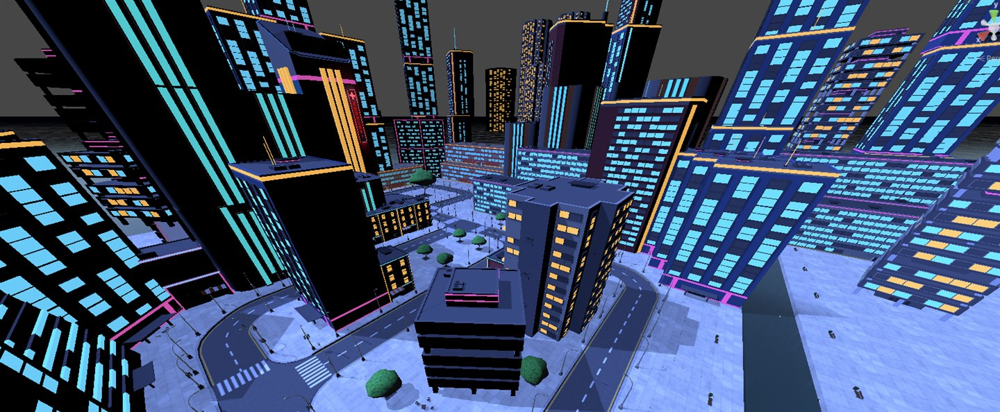
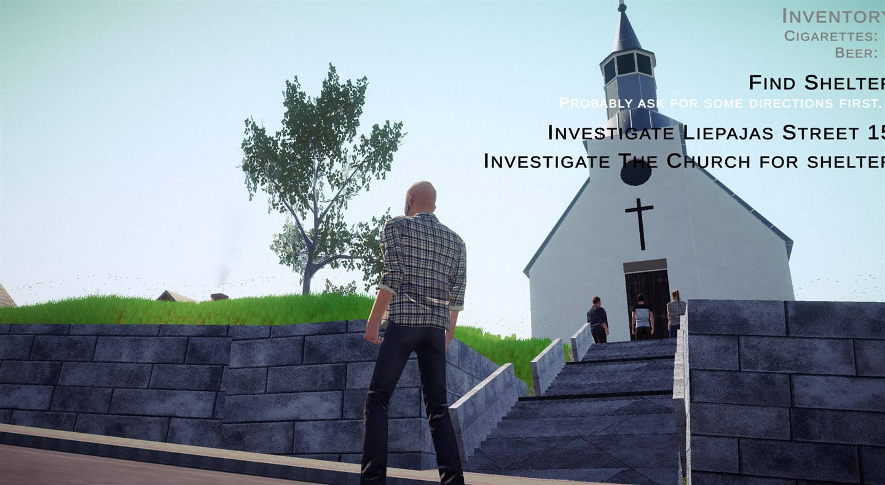
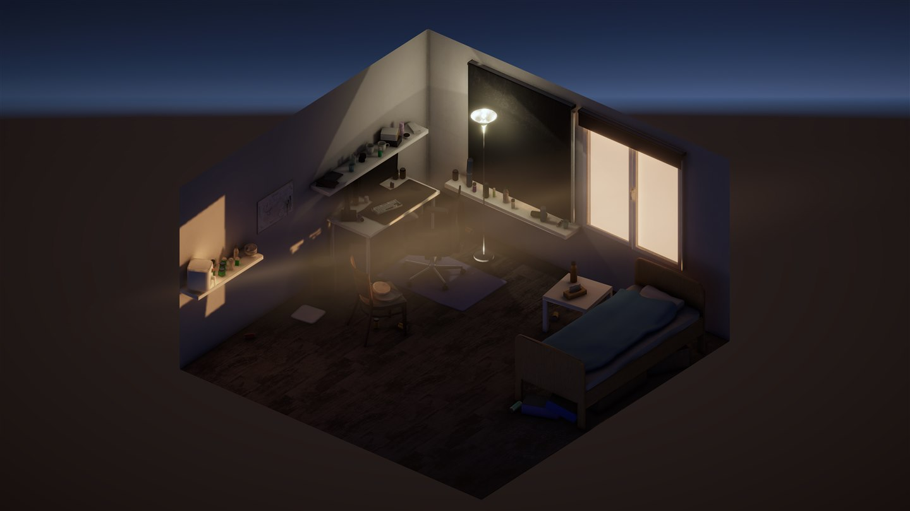

# Mārtiņš Dāvis Bernhards

I’m a software developer from Latvia, based in Enschede. I study Applied Computer Science at Saxion, currently in year 4 (expected graduation: 2027) and have around three years of C#/.NET experience at Accenture Baltics.

I make games with Godot in my free time and used Unity during my game design minor. I’m looking for a graduation internship.

**[Portfolio website](https://mdbernhards.github.io/portfolio/)**

[GitHub](https://github.com/mdbernhards) · [LinkedIn](https://www.linkedin.com/in/mdbernhards/)

## Games

### Sector 7

A four person university investigation game about misinformation. I built the DataRig and much of the evidence system, and designed and assembled the level. Teammates contributed the final UI, photography and scoring; environment models are imported. Only day one is playable in the prototype.

**Unity 6 · C# · Yarn Spinner**  
[Source showcase](https://github.com/mdbernhards/sector-7) · [Watch gameplay](https://youtu.be/kGgeZPuvfn4)

### Impact Event

A walking simulator set in a Latvian town after a meteor warning. I made the town layout, story, dialogue and gameplay scripts, building on a provided framework. An unfinished individual university prototype.

**Unity 6 · C# · Yarn Spinner**  
[Selected source](https://github.com/mdbernhards/ImpactEvent/tree/public-source) · [Short walkthrough](https://youtu.be/p-6shZrW_6w)

### Beaver Incremental

My personal incremental game about collecting wood, buying upgrades and building a dam. Includes research, magic, fishing and save/load support. Released as a download on itch.io.

**Godot 4.3 · GDScript**  
[Source code](https://github.com/mdbernhards/BeaverIncremental) · [Get the game](https://catgizmo.itch.io/beaver-incremental)

### Pixel Pinball

My 2D pinball game with a charged launcher, bumpers, portals and timed combos. Play in your browser.

**Godot 4.2 · GDScript**  
[Source code](https://github.com/mdbernhards/Pinball) · [Play in browser](https://catgizmo.itch.io/pixel-pinball)

## 3D modelling

[Maya 3D Modelling Projects](https://github.com/mdbernhards/Maya-3d-projects) — a bedroom diorama I modelled and textured for Saxion’s Art Fundamentals module, plus the church model I made for Impact Event. Tools: Maya, Substance 3D Painter and Unity.

## Other software projects

- [GameGizmo](https://github.com/mdbernhards/GameGizmo) — a C# / WPF app for browsing games through the RAWG API, with search filters and MVVM.
- [Animal Shelter Web Application](https://github.com/mdbernhards/WebDzivniekuPatversme) — a Latvian-language ASP.NET Core / MySQL website for browsing shelter animals and managing listings. A 2021 qualification project at Rīgas Valsts tehnikums.

## Technical skills

C# · .NET · Unity · Godot · GDScript · WPF · ASP.NET Core · SQL · Rust · C++ · Git  
Maya · UV mapping · Substance 3D Painter

[Connect with me on LinkedIn](https://www.linkedin.com/in/mdbernhards/).